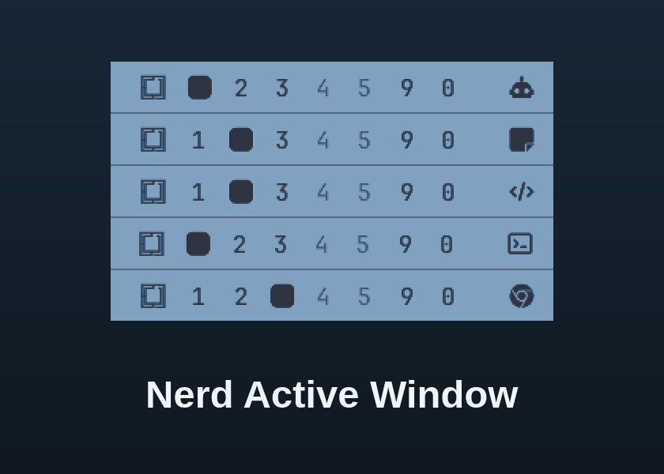
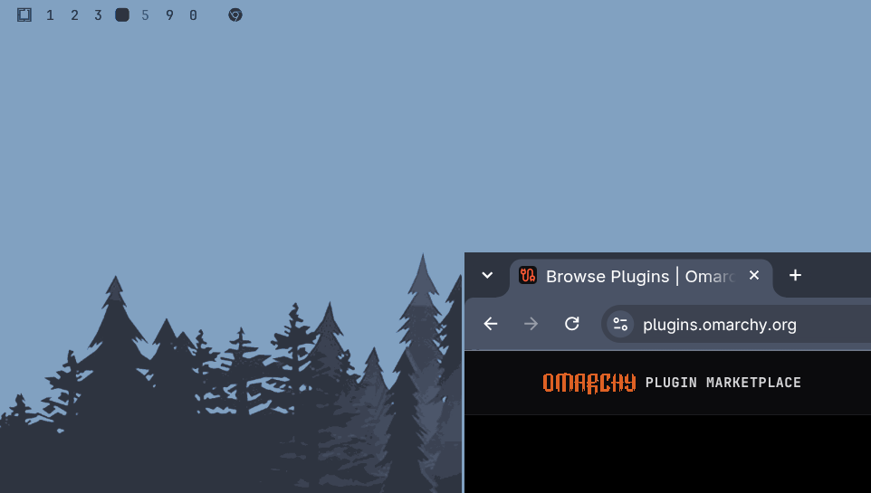

# Nerd Active Window for Omarchy

An unofficial Omarchy bar widget that shows the active application's icon
without taking up space for its title. Its monochrome icon follows the
current Omarchy theme. Hover over it to see the window title and class.
The widget hides when there is no active window on the bar's monitor
and current workspace.

Plugin ID: `jmihbay.nerd-active-window`.



## Requirements

- Omarchy with its Quickshell bar and Hyprland
- Python 3
- JetBrainsMono Nerd Font (included in Omarchy's base packages as `ttf-jetbrains-mono-nerd-basic`)

## Install

Once the first release is published on GitHub, install and enable it with:

```bash
omarchy plugin add https://github.com/jmihbay/omarchy-nerd-active-window.git --enable
```

For readability, place the icon to the right of the workspace list and put
Omarchy's built-in Spacer widget between them. Move the icon first, then
insert the spacer:

```bash
omarchy bar move jmihbay.nerd-active-window --after omarchy.workspaces
omarchy bar put omarchy.spacer --before jmihbay.nerd-active-window
```

If you use a custom workspace widget, substitute its plugin ID after
`--after`. If you already have a spacer between the widgets, keep it there.



Update or remove a Git-managed installation with Omarchy's plugin manager:

```bash
omarchy plugin update jmihbay.nerd-active-window
omarchy plugin remove jmihbay.nerd-active-window
```

To hide the widget temporarily, run
`omarchy plugin disable jmihbay.nerd-active-window`. To show it again, run
`omarchy plugin enable jmihbay.nerd-active-window`.

## Customize icons

Create either or both of these optional files:

- `~/.config/omarchy/nerd-active-window/icons-rules.json` for Nerd Font glyphs.
- `~/.config/omarchy/nerd-active-window/vector-icons-rules.json` for SVG paths.

If `XDG_CONFIG_HOME` is set, use it in place of `~/.config`. Create the
`omarchy/nerd-active-window` directory if needed. The files live outside the
plugin checkout so your rules stay in place during plugin updates. Include
only the rules you want to add or override.

Each file contains an array. The widget checks user vector rules, user font
rules, bundled vector rules, then bundled font rules. Within each file the
first matching entry wins. Without any match, the widget shows a generic
window icon. See [default-icons-rules.json](default-icons-rules.json) and
[default-vector-icons-rules.json](default-vector-icons-rules.json) for the
bundled rules. Whole lines beginning with `//` are treated as comments.

### Nerd Font glyphs

List case-insensitive fragments of an app's Hyprland class or initial class
under `match`. Set `codepoint` to the hexadecimal Nerd Font code point.
The widget tooltip shows the current class. For example, to give Chromium a globe:

```json
[
  {"match": ["chromium"], "codepoint": "F0AC"}
]
```

### Vector icons

Vector rules match the current window class. Set `width` and `height` to the
dimensions of the SVG coordinate system and `path` to the SVG path's `d`
attribute. Use coordinates relative to a viewBox starting at `0 0`.

```json
[
  {"match": ["org.example.myapp"], "width": 16, "height": 16, "path": "M8 1 L15 15 H1 Z"}
]
```

## How it works

The widget responds to Hyprland window and workspace events. A Python
helper queries local Hyprland state through `hyprctl` and returns the window
title and classes to the widget. These details are used locally in the bar
and tooltip. The plugin makes no network requests and needs no root access.

If the bar retains old rules after an edit or update, reload Omarchy with
`omarchy restart shell`.

## Validate a checkout

From the plugin directory, run:

```bash
omarchy plugin validate .
```

## License

GPL-3.0-only. See [LICENSE](LICENSE).

Copyright (C) 2026 jmihbay for the plugin code and documentation.
